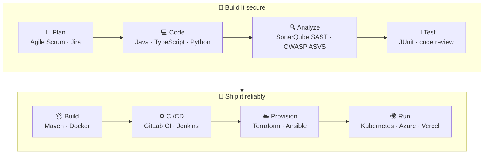

<div align="center">


<p>
  <a href="https://haddani-abdu.vercel.app/"></a>
  <a href="https://www.linkedin.com/in/abderazak-haddani"></a>
  
  
</p>

</div>

---

### `$ whoami`

```yaml
name:        Abderazak Haddani
school:      ENSIBS Vannes — Engineering degree, Software Cybersecurity (Master's level)
background:  ENSET Mohammedia (Software Engineering) · Moulay Ismail University (BSc Software Engineering)
role:        Full stack developer with a security-first mindset
loves:       clean architecture · REST APIs · DevSecOps pipelines · AI agents
languages:   Arabic (native) · French (fluent) · English (fluent)
looking_for: 6-month Full Stack / Software Engineering internship starting 2027
```

---

### 🛡️ How I ship software — *security shifted left*

Every tool below is one I have actually used in a project. Each stage of the pipeline is where it lives.



---

### 🧰 Tech stack

<table>
  <tr>
    <td align="center" width="150"><b>Languages</b></td>
    <td></td>
  </tr>
  <tr>
    <td align="center"><b>Backend</b></td>
    <td><br/>
    <sub>Spring Boot · Spring Security · Spring Data JPA · Hibernate · NestJS · Express · FastAPI · Laravel · REST · microservices · API Gateway</sub></td>
  </tr>
  <tr>
    <td align="center"><b>Frontend & Mobile</b></td>
    <td><br/>
    <sub>React · Next.js · Angular · Redux · Thymeleaf · Flutter (BLoC) · Ionic + Capacitor</sub></td>
  </tr>
  <tr>
    <td align="center"><b>Databases</b></td>
    <td><br/>
    <sub>PostgreSQL · MySQL · Oracle · SQL Server · MongoDB · Redis</sub></td>
  </tr>
  <tr>
    <td align="center"><b>DevOps & Cloud</b></td>
    <td><br/>
    <sub>Git · GitLab CI/CD · Jenkins · Docker · Kubernetes · Terraform · Ansible · Azure · Vercel · Maven</sub></td>
  </tr>
  <tr>
    <td align="center"><b>Security</b></td>
    <td>
      
      
      
      
      
      
      
    </td>
  </tr>
  <tr>
    <td align="center"><b>AI & Data</b></td>
    <td>
      
      
      
      
      
      
      
    </td>
  </tr>
  <tr>
    <td align="center"><b>Practices</b></td>
    <td><sub>OOP · SOLID · layered & microservice architecture · unit testing · code review · refactoring · Agile Scrum · Jira</sub></td>
  </tr>
</table>

---

### 🚀 Featured projects

| Project | What it is | Stack |
|---|---|---|
| 🏆 [**leetcode-league-api**](https://github.com/HADDANIAbdu/leetcode-league-api) | REST API for a weekly LeetCode league between friends: daily tracking, speed race, shared pot | NestJS · PostgreSQL · JWT |
| 🏗️ [**ansible-terraform-IaC**](https://github.com/HADDANIAbdu/ansible-terraform-IaC) | Rebuild a full environment from zero in one command: Terraform provisions, Ansible configures | Terraform · Ansible |
| 🧩 [**api-gateway**](https://github.com/HADDANIAbdu/api-gateway) + services | Microservice e-commerce platform: catalog, order, payment, delivery, notification and user services | Java · microservices |
| 🔐 [**jwt-opaque-google-auth**](https://github.com/HADDANIAbdu/jwt-opaque-google-auth-backend) | Hybrid authentication with JWT and Google OAuth2, roles, profile pictures; [Next.js](https://github.com/HADDANIAbdu/jwt-opaque-google-auth-nextJS) and [Angular](https://github.com/HADDANIAbdu/jwt-opaque-google-auth) clients | Spring Boot · Next.js · Angular |
| 🎟️ [**events-app**](https://github.com/HADDANIAbdu/events-app) | Event platform: booking, admin, PayPal payments, automated e-mails, role-based security | Spring Boot · Thymeleaf · PostgreSQL |
| 🏦 [**e-bank-backend**](https://github.com/HADDANIAbdu/e-bank-backend) | Secure banking API: clients, accounts and operations, layered architecture, JUnit tests | Spring Boot · Spring Security · [Angular](https://github.com/HADDANIAbdu/e-bank-frontend) |
| 📊 [**BizServe-api**](https://github.com/HADDANIAbdu/BizServe-api) | Client and payment management system built during my internship at an architecture firm | Laravel · [React](https://github.com/HADDANIAbdu/BizServe-frontend) |
| 🧠 [**Sentiment-analysis-with-ML**](https://github.com/HADDANIAbdu/Sentiment-analysis-with-ML) | Arabic & Moroccan sentiment analysis on 3,000 Facebook comments, 6 classifiers compared | Python · ML · Jupyter |

---

### 💼 Experience at a glance

```text
2025-09 → 2026-01  Project lead & Java backend dev · E-SCOLIS (ENSIBS)
                   2 Spring Boot microservices, ~10 REST endpoints, GDPR/OWASP ASVS audit → 9 vulns fixed
2025-06 → 2025-08  AI intern & full stack dev · AGA DISPA SERVICE (Agadir)
                   Multi-agent RAG chatbot (FastAPI, LangGraph, 4 agents) integrated into a web app
2024-06 → 2024-09  Web developer intern · Elaouad Architecture & Engineering (Casablanca)
                   Management web app: React front end, Laravel API (15 endpoints), 7-table database
```

---

### 📈 GitHub activity

<div align="center">
  
  
</div>

---

<div align="center">
  <sub>🔒 Secure by design · 🧱 Clean by default · 🤖 Curious about AI agents</sub>
</div>
